# Versión 0.6.0 · «La gran huida»

Quinto capítulo y cierre de la primera temporada. Agrega un mapa nuevo (Cabecera del Llano), parkour por terrazas, drones de vigilancia, una tirolesa, cinemáticas cortas que se pueden saltar y un final con cuenta regresiva al amanecer. Todo lo anterior (capítulos 1 a 4, perfil, tienda, logros) sigue igual.

## 1. Auditoría de partida

| Área | Estado en 0.5.0 | Qué faltaba |
|---|---|---|
| Motor | Godot 4.7.2, GDScript, Jolt, Forward+ en PC y Compatibilidad en web | Nada: se mantiene |
| Mapas | Una sola manzana de prueba para los cuatro capítulos | Un lugar reconocible de Bucaramanga con altura (parques, terrazas, quebrada) |
| Movimiento | Correr, saltar, trepar muros bajos, deslizarse | Consecuencias de las caídas, rodar, tirolesa, sensación de impacto |
| IA | Policía a pie, vigilantes, cámaras fijas | Una amenaza aérea que obligue a usar sombra y escondites |
| Narrativa | Textos en la portada y en la victoria | Escenas cortas con cámara propia que se puedan saltar |
| Interfaz | Portada, capítulos, perfil, tienda, logros | Créditos, estadísticas del jugador, título al entrar a cada zona |
| Progresión | 4 capítulos, 12 logros, 10 postales | Capítulo final, logros de parkour, postales del nuevo mapa |

## 2. El capítulo

**Cuándo:** de madrugada (4:50 a. m.); el cielo se aclara mientras avanza la huida.
**Dónde:** Cabecera del Llano, inspirada en el Parque de las Palmas, la Carrera 33, las torres y el centro comercial de la zona y una cañada con un puente.

| Paso | Objetivo | Cómo se resuelve |
|---|---|---|
| 1 | Encuentra a Lucía, la periodista, en la fuente | Hablar con ella (E) en la fuente del parque |
| 2 | Sube a las terrazas por la escalera de incendios | Escalera al sur de la primera terraza |
| 3 | Cruza las terrazas hasta la oficina de El Búho | Cinco terrazas a distinta altura: saltos con carrera, una tabla, toldos para esconderse del dron y un vigilante en la última |
| 4 | Abre la caja fuerte y saca el contrato | La clave (1622, el año de fundación de la ciudad) está en una nota del escritorio y en la placa del monumento del parque. Cada clave equivocada sube la búsqueda |
| 5 | Escapa por la tirolesa hacia el parque | Al abrir la caja suena la alarma: llegan dos patrullas, dos policías y dos drones más. La tirolesa baja de la última terraza al mirador del parque |
| 6 | Cruza el Puente de la Novena antes del amanecer | Desde la tirolesa corre una cuenta de 170 s. Si sale el sol antes, Lucía tiene que irse y se pierde |

Tres corazones. Se pierde uno si te atrapan o si caes desde más de unos 9 m sin rodar. Sin corazones, o si amanece, aparece la pantalla de derrota con «Reintentar». Los puntos de control son el inicio en el parque, la primera terraza, la puerta de la oficina y el mirador del parque.

Hay tres cinemáticas (inicio, alarma y final) de 8 a 14 segundos, con franjas negras y subtítulos. Se saltan con E, Espacio, Esc, un clic o un toque. Se pueden desactivar en Configuración.

## 3. Sistemas nuevos

| Sistema | Archivo | Qué hace |
|---|---|---|
| Mapa de Cabecera | `src/world/cabecera/cabecera_builder.gd` | 140 × 140 m: parque con fuente con chorros, palmas, monumento, kiosco y granizados; avenida con separador de palmas; cinco terrazas; calle de servicio; dos torres con luz de aviación; centro comercial; cañada con puente en arco; plaza final con la camioneta de la emisora |
| Zonas con título | `src/world/zones/zone_trigger.gd` | La primera vez que entras a una zona aparece su nombre (Parque de las Palmas, Carrera 33, Terrazas de Cabecera, Puente de la Novena…) |
| Rodar y caída dura | `src/player/states/roll_state.gd`, `hard_land_state.gd` | Desde unos 2,5 m: si mantienes C o vienes corriendo, ruedas y sigues. Desde unos 4 m sin rodar te aturdes medio segundo. Desde unos 9 m, además pierdes un corazón |
| Tirolesa | `src/interaction/zipline.gd`, `src/player/states/zipline_state.gd` | Te cuelgas con E, bajas a 13 m/s con sonido propio, y te sueltas con Espacio o al llegar |
| Drones | `src/ai/drone/surveillance_drone.gd` | Patrullan a 8,5 m con un cono de luz. Si te ven 0,9 s, te siguen, suben la búsqueda y avisan. Bajo un toldo o agachado dentro de un matorral no te ven. Si te pierden 2,2 s, buscan y vuelven a su ruta |
| Cinemáticas | `src/camera/cinematic_director.gd` | Planos con movimiento de cámara y subtítulo; bloquean el control del jugador mientras duran |
| Sacudida de cámara | `src/camera/third_person_camera.gd` | Golpes, caídas y alarmas sacuden la cámara; con «Reducir animaciones» baja al 30 % |
| Pasos | `src/player/prototype_body.gd` | Sonido de pasos al caminar y correr; agachado no suena |
| Amanecer | `src/world/time_of_day.gd` | Horas «madrugada» y «amanecer» y mezcla gradual entre ellas |
| Caja fuerte | `src/interaction/safe_box.gd` | Puerta que gira y piloto que pasa de rojo a verde |
| Teclado general | `src/ui/escape/code_lock_panel.gd` | El teclado del capítulo 1 sirve ahora para cualquier misión que defina `code_panel()` y `try_code()` |

## 4. Interfaz y progresión

- **Créditos** en la portada (autoría, motor, arte y sonido propios, tipografías OFL, aviso de ficción).
- **Estadísticas** en el perfil: tiempo jugado, capítulos, saltos, muros, deslizadas, rodadas, latas, veces atrapado, tirolesas, alarmas de dron y distancia recorrida. Se guardan en `user://perfil.cfg` y también hay récords por capítulo.
- **Esc** vuelve a la portada desde cualquier página del menú.
- **4 logros nuevos** (16 en total): La gran huida, Rey de las terrazas (terrazas en menos de 75 s), Acróbata (10 rodadas) y Bumangués de corazón (las 15 postales).
- **5 postales nuevas** (15 en total) en Cabecera: Capital de Santander, Parque García Rovira, El Santísimo, Casa de Bolívar y El Alfonso López.
- El final del capítulo 4 lleva ahora al capítulo 5. El 5 cierra la temporada.

## 5. Audio nuevo

Generado con `python3 tools/generate_audio.py --v06` (síntesis propia):

- Música del final.
- Bucles 3D del dron y de la tirolesa.
- Efectos de pasos, rodada, golpe, título de zona, cinemática, alerta del dron, caja fuerte y arranque de la tirolesa.

## 6. Rendimiento

- La geometría repetida del mapa (palmas, bandas de vidrio de las torres, bancas) va en MultiMesh. El navmesh se hornea una vez al cargar.
- Los faroles y los bombillos de las terrazas solo encienden luces de noche y sin sombras.
- Los chorros de la fuente se apagan con «Reducir animaciones».
- No se midieron FPS (el entorno de pruebas no tiene GPU). La versión web cargó y se jugó en Chromium con SwiftShader, que es render por software.

## Capturas

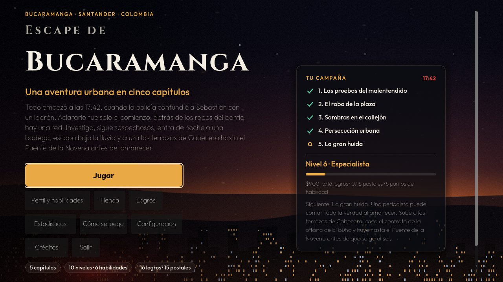
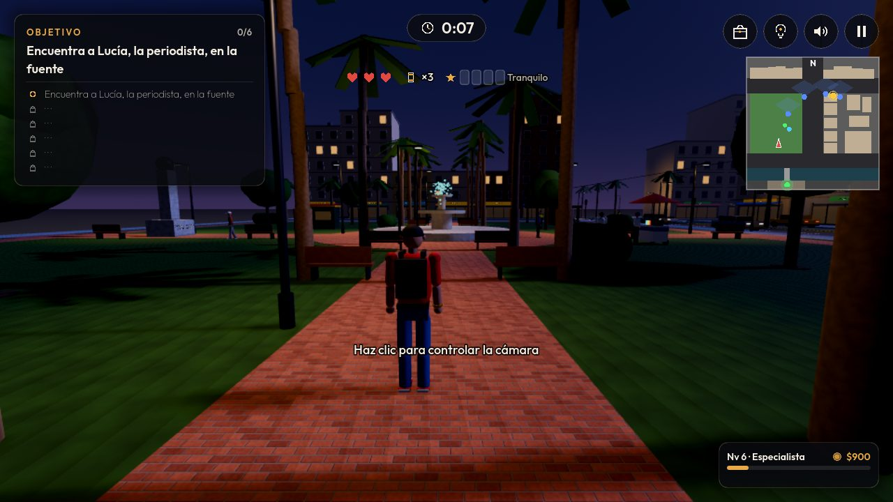
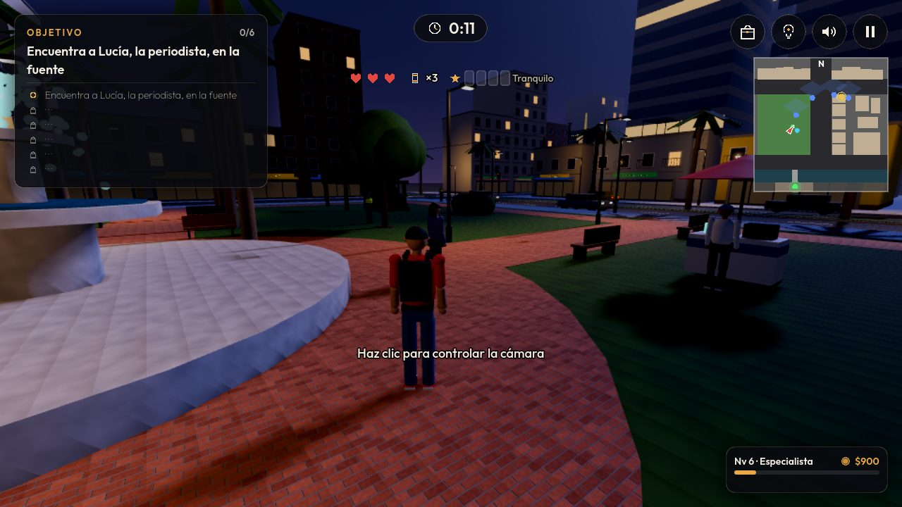
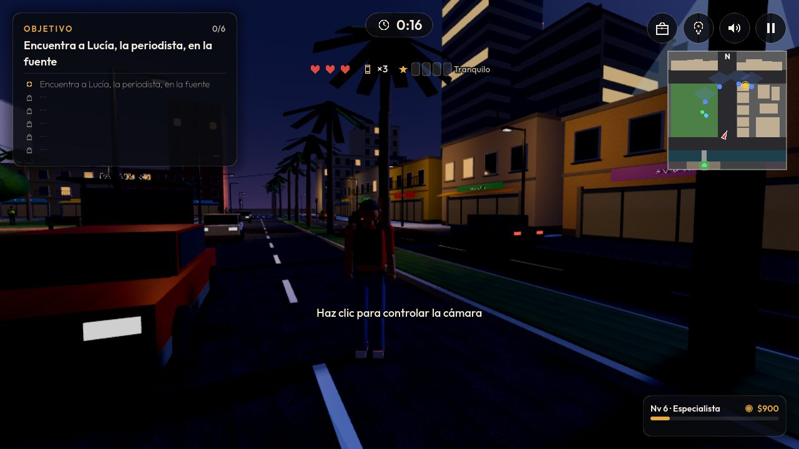
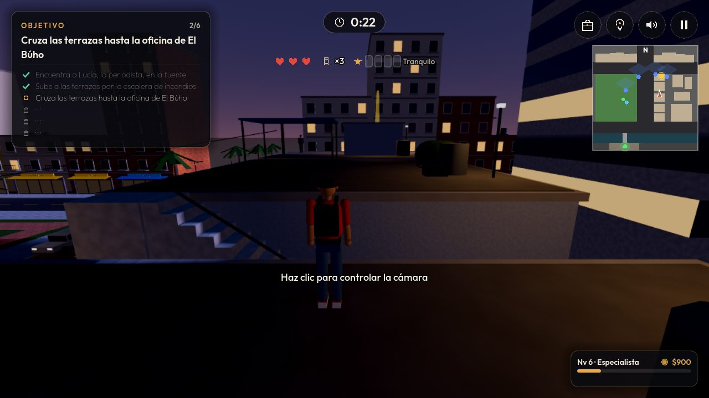
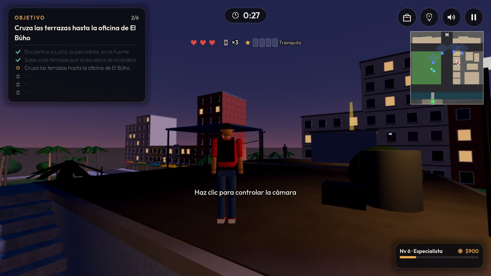
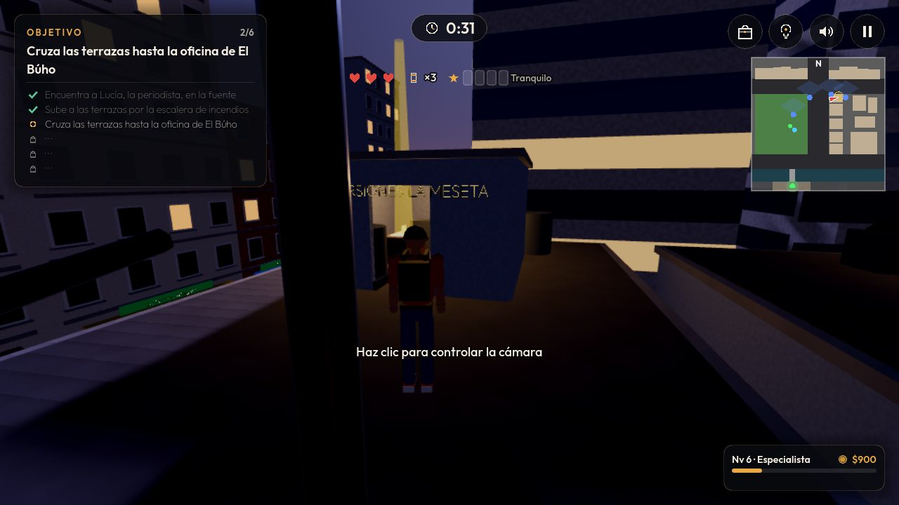
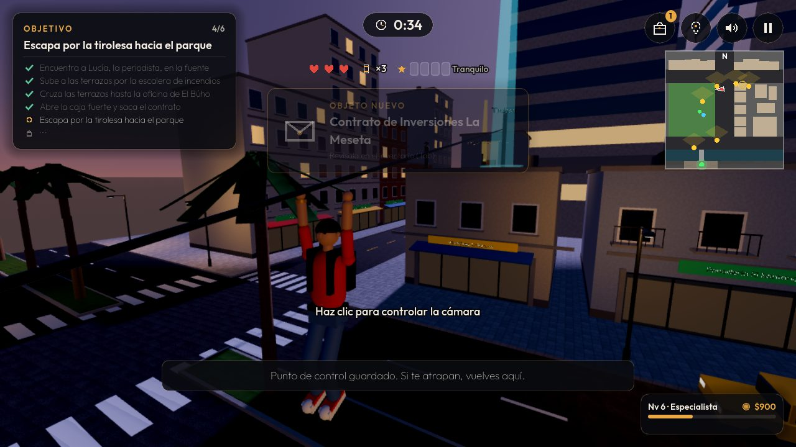
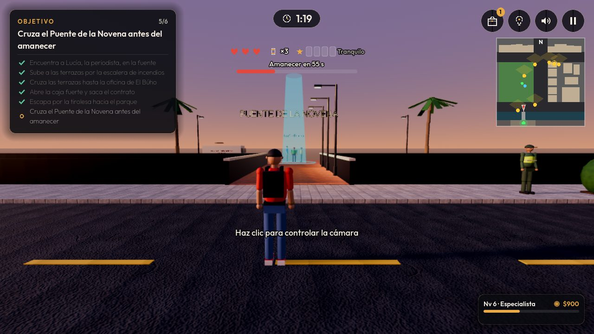
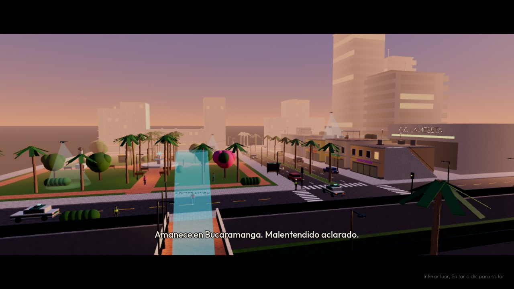
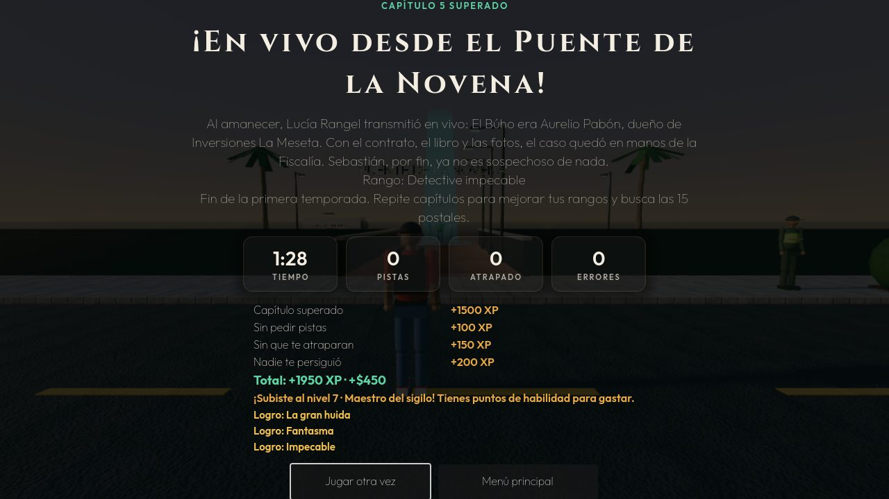
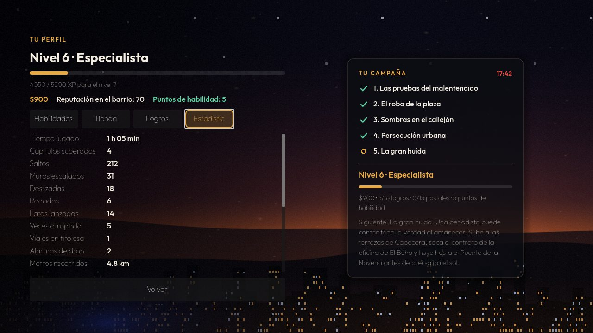
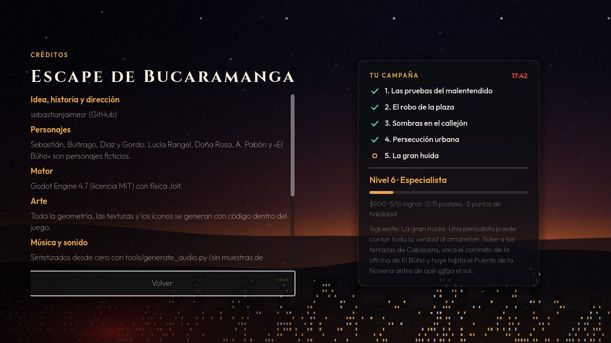
