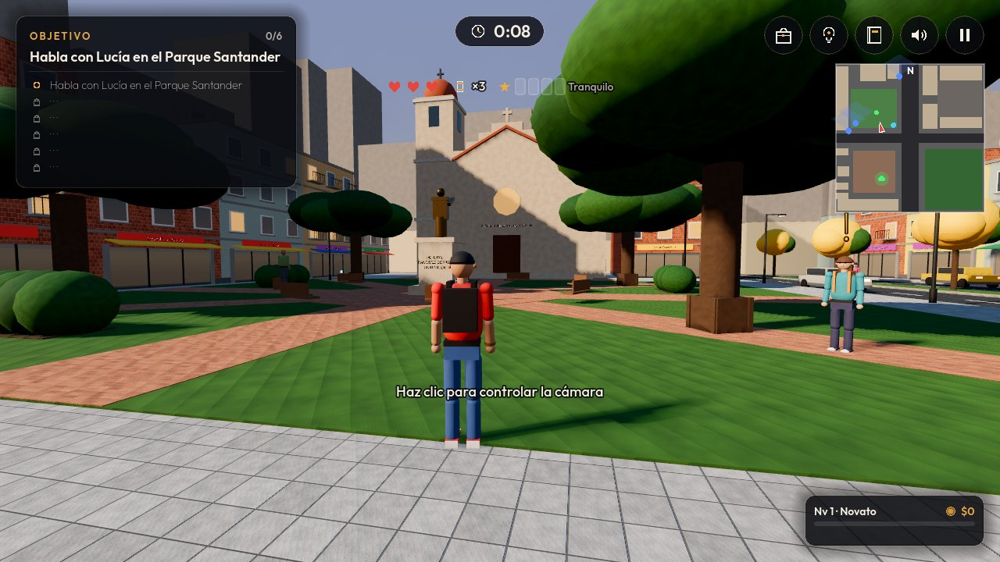
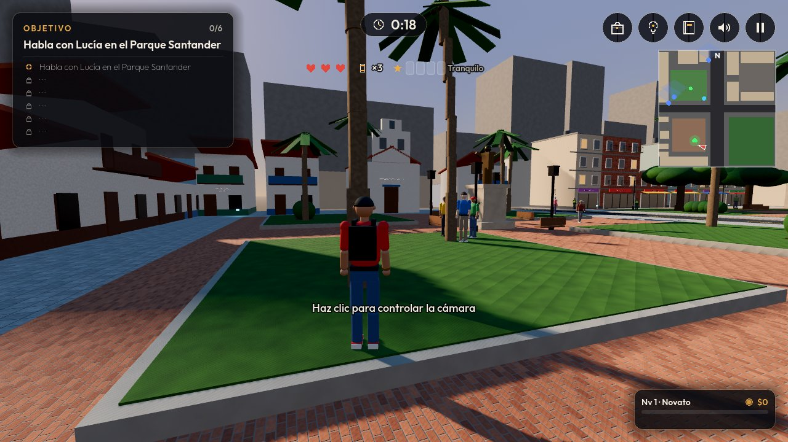
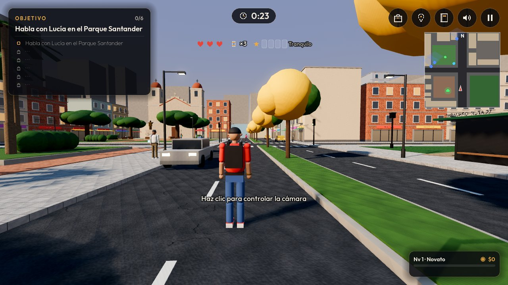
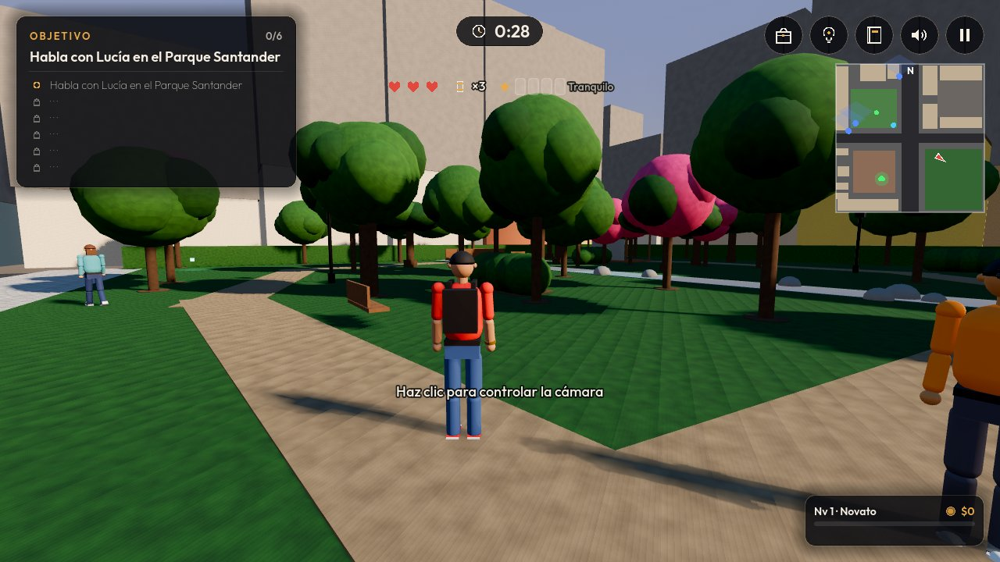
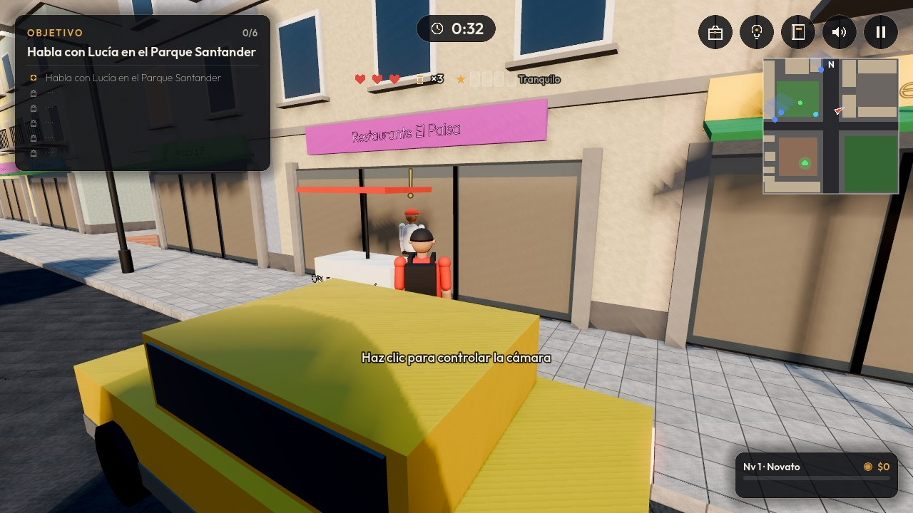
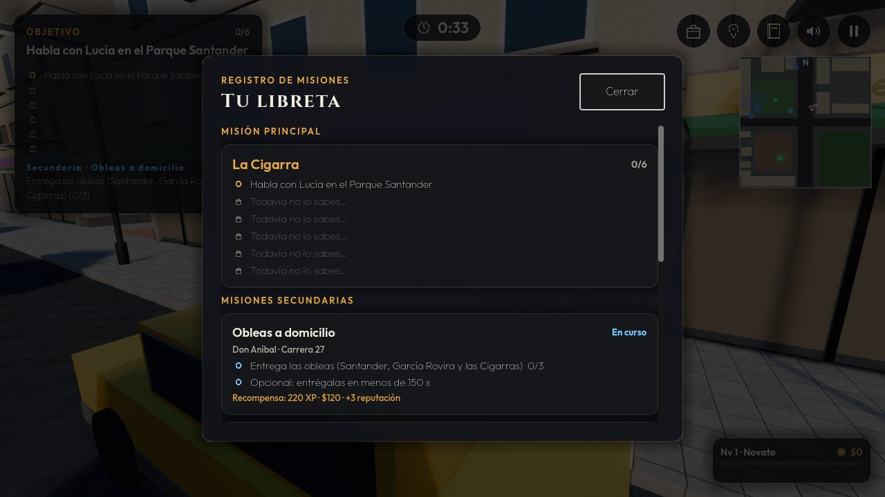
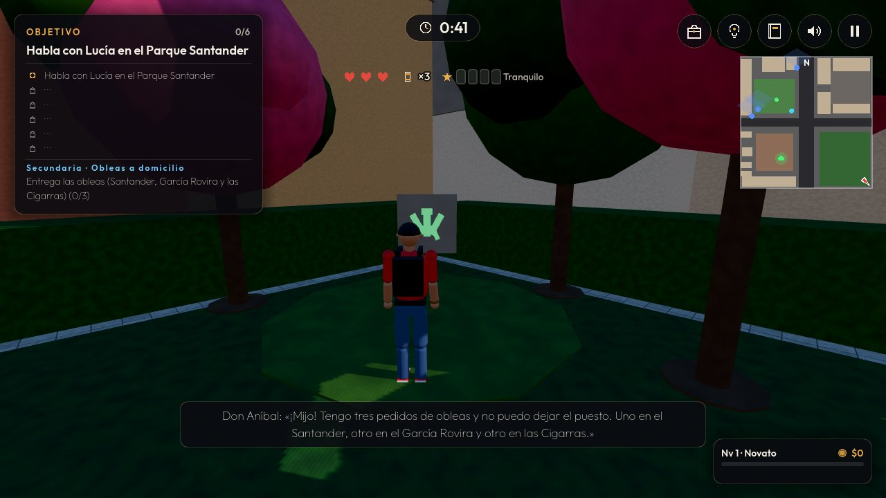
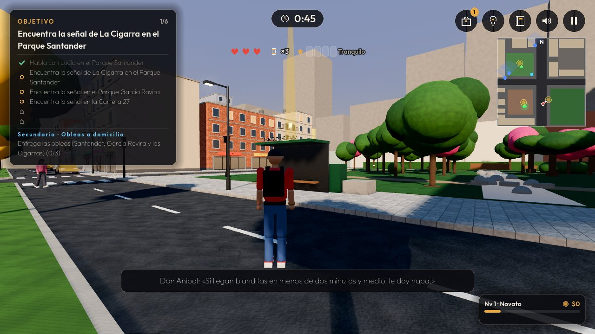

# Escape de Bucaramanga 2.0

Versión 2.0.0 (17 de noviembre de 2026). Evoluciona la 0.6.0 sin rehacerla: se conservan los cinco capítulos, el motor (Godot 4.7), la historia y todos los sistemas. Lo nuevo es el distrito **El Centro**, el **capítulo 6 «La Cigarra»**, **misiones secundarias** con personajes que las entregan, un **evento inesperado**, **secretos** y un **registro de misiones**.

## 1. Auditoría (fase 1)

Lo que se comprobó antes de tocar nada:

| Qué | Resultado |
|---|---|
| Pruebas automáticas | 89 de 89 pasan (`tests/test_runner.tscn`) |
| Versión web exportada y abierta en Chromium | Carga hasta la portada; sin errores de JavaScript |
| Motor y estructura | Godot 4.7, unas 14.300 líneas de GDScript en `src/` (jugador, IA, misiones, mundo procedural, interfaz, audio) |
| Sitio publicado | GitHub Pages seguía en la 0.5.0: el capítulo 5 no se podía jugar en línea |

Problemas encontrados:

1. **Bucaramanga casi no aparecía.** Los capítulos 1 a 4 pasan en una manzana genérica. No estaban el Parque Santander, el Parque de las Cigarras ni la Carrera 27. La postal del **Parque García Rovira** y la de la **Casa de Bolívar** estaban puestas en el mapa de Cabecera, aunque los dos lugares están en el centro.
2. **Todo era lineal.** No había misiones secundarias, ni personajes que las entregaran, ni un registro de misiones, ni eventos inesperados.
3. **Poca respuesta al cumplir un objetivo.** Solo se actualizaba la lista del HUD.
4. **Caras casi vacías.** Los personajes no tenían cejas ni boca.

## 2. Lo nuevo

### El Centro (`src/world/centro/centro_builder.gd`)
El mapa mide 120 × 120 m. Lo cruzan dos vías: la **Carrera 27**, con un separador de guayacanes en flor, y la **Calle 36**. Las cuatro cuadras que quedan son:

- **Parque Santander.** Tiene una estatua sobre un pedestal con placa, ceibas enormes, senderos en cruz y en diagonal, bancas y granizados. Al norte está la **Catedral de la Sagrada Familia**, con dos torres, cúpulas, rosetón y atrio.
- **Parque García Rovira.** Una plaza de adoquín con cuatro jardines de palmas, faroles coloniales y una estatua. Al lado están la **Capilla de los Dolores**, blanca y con espadaña de campanas, las casas coloniales con balcones y la **Casa de Bolívar**.
- **El comercio de la 27.** Locales con vitrinas y letreros, un **pasaje** con guirnalda de bombillos, un patio de atrás y una **escalera de incendios** que sube a una terraza.
- **Parque de las Cigarras.** Un bosque con senderos de gravilla y una quebrada. Se cruza por un puente de madera o saltando por las piedras. También tiene un kiosco de casilleros y un claro escondido.

Fuera del área jugable, el horizonte se llena con edificios para que la ciudad no termine en el vacío.

Todo está inspirado en la ciudad; no son reproducciones exactas.

### Capítulo 6 · «La Cigarra» (`src/missions/centro_mission.gd`)
Continúa la historia sin cambiar nada de lo que ya pasó. El libro de cuentas del capítulo 3 hablaba de «un amigo en la estación». Ahora alguien que firma «La Cigarra» tiene la prueba. Los pasos son estos:

1. Hablar con Lucía en el Parque Santander.
2. Encontrar las tres señales, en cualquier orden. Cada una es un acertijo:
   - En el Parque Santander: cuántas alas tiene una cigarra (4).
   - En el García Rovira: cuántos robos cometió Sebastián (0).
   - En la Carrera 27, encima del paradero: el número de la carrera (27).
3. Abrir el casillero 27 del Parque de las Cigarras con la clave **4027**. Al abrirlo llega la patrulla del sargento Ordóñez (policía ficticia y sin violencia).
4. Llevarle la grabación a Lucía en el García Rovira.

El capítulo tiene cinemática de entrada y de final, y un desenlace que deja una pregunta abierta.

### Misiones secundarias (`src/quests/`)

| Misión | Quién la da | Qué hay que hacer | Recompensa |
|---|---|---|---|
| Obleas a domicilio | Don Aníbal (Carrera 27) | Entregar 3 pedidos en tres parques. Hay un bono opcional por hacerlo en menos de 150 s | 220 XP, $120 y el bono |
| Postales vivas | Mariana (Parque Santander) | Tomar fotos de la Catedral, la Capilla y la Casa de Bolívar, y volver con ella | 200 XP y $80 |
| ¿Dónde está Firulais? | Doña Carmen (García Rovira) | Encontrar al perro en el bosque y llevarlo de vuelta. El perro te sigue | 250 XP y $100 |
| ¡Raponazo! (evento) | Una señora (Carrera 27) | Aparece sin aviso. Hay que alcanzar al raponero antes de que se pierda y devolver el bolso | 150 XP y $60 |

- Sobre la cabeza de quien tiene una misión aparece un **«!» dorado**; cuando ya se puede entregar, aparece un **«?»**.
- El HUD muestra la secundaria que estás siguiendo, con su progreso.
- Las recompensas se cobran una sola vez y quedan en el perfil.

### Secretos y postales
- **5 cigarras pintadas** escondidas: en una terraza, junto a la capilla, en el claro del bosque, al fondo del pasaje y a la sombra de una torre de la catedral. Se fotografían con Interactuar y dan XP. Las cinco dan el logro «Cazador de cigarras».
- **19 postales** en total, 4 de ellas nuevas. La del García Rovira y la de la Casa de Bolívar se movieron a su lugar real, el Centro. Quien ya las tenía las conserva.
- **5 logros nuevos** (21 en total): La Cigarra, Buen vecino, Cazador de cigarras, Guía de la ciudad y Descifrador. «Bumangués de corazón» sigue pidiendo 15 postales.

### Interfaz
- **Registro de misiones** con la tecla **J** (también con el botón de la libreta, arriba a la derecha). Muestra la misión principal con sus pasos, las secundarias con su estado, sus objetivos y su recompensa, y lo que falta por descubrir, con pistas de las cigarras que te faltan. Funciona en todos los capítulos.
- Aviso **«✓ Objetivo cumplido»** con animación y partículas cada vez que se cumple un objetivo; al ganar un capítulo, la celebración es más grande.
- La tecla J se puede reasignar en Configuración, y la guía de controles y «Cómo se juega» ya la mencionan.
- Corregido: con cinco botones, el de pausa se salía de la pantalla a 1280 × 720.

### Personajes
- Los personajes tienen ahora cejas y boca.
- Personajes nuevos: Don Aníbal, Mariana, Doña Carmen, tres clientes, la señora del bolso, el raponero (`src/ai/civilians/snatcher.gd`) y **Firulais** (`src/ai/civilians/stray_dog.gd`), un perro hecho con primitivas que mueve la cola y te sigue.

### Guardado
- El perfil guarda dos claves nuevas, `quests_done` y `secrets`. Un perfil de la 0.6 se carga igual, con esas dos claves vacías. Los valores desconocidos o mal formados se descartan.
- La partida en curso del capítulo 6 guarda el progreso de las secundarias. Si el raponazo estaba a medias, se cancela al cargar en lugar de quedar roto.

## 3. Pruebas

**103 pruebas automáticas, todas OK.** Son las 89 anteriores más 14 nuevas:

- **El mapa:** zonas, postales, que nada importante quede dentro de un edificio y que el paradero se pueda escalar.
- **El capítulo 6:** completo de principio a fin, y que el casillero no abra sin las tres señales.
- **Cada misión secundaria**, el **evento del raponazo** y los **secretos**.
- **El registro de misiones**, incluida la tecla J.
- **El guardado:**
  - «Continuar» con secundarias en curso.
  - Datos dañados en el registro de misiones.
  - Un perfil de la 0.6 sin las claves nuevas.
- **La celebración** al cumplir un objetivo.

```bash
godot --headless --path . --fixed-fps 60 res://tests/test_runner.tscn
godot --path . --rendering-method gl_compatibility --resolution 1280x720 res://tests/v20_screenshots.tscn -- <carpeta> [bajo|medio|alto]
```

También se exportó la versión web y se probó en Chromium. Se cargó un perfil con el formato de la 0.6 y con cinco capítulos terminados. La portada muestra los seis capítulos, y el capítulo 6 carga y se juega en el navegador sin errores de JavaScript.

No se pudo probar aquí: un celular físico y los FPS reales, porque el entorno no tiene GPU.

## 4. Capturas










## 5. Mejoras futuras

1. Llevar misiones secundarias a la manzana de los capítulos 1 a 4 y a Cabecera: el sistema (`QuestTracker` y `SideQuests`) ya es general.
2. Más eventos inesperados, como un aguacero repentino o una ciclovía.
3. Modelos animados definitivos para los personajes.
4. Medir el rendimiento en celulares reales de gama media.
