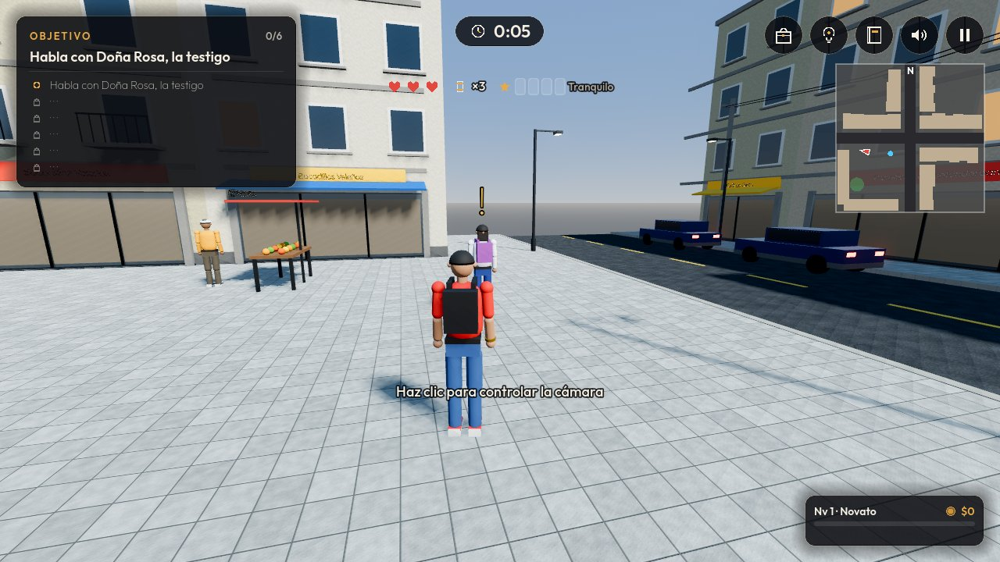
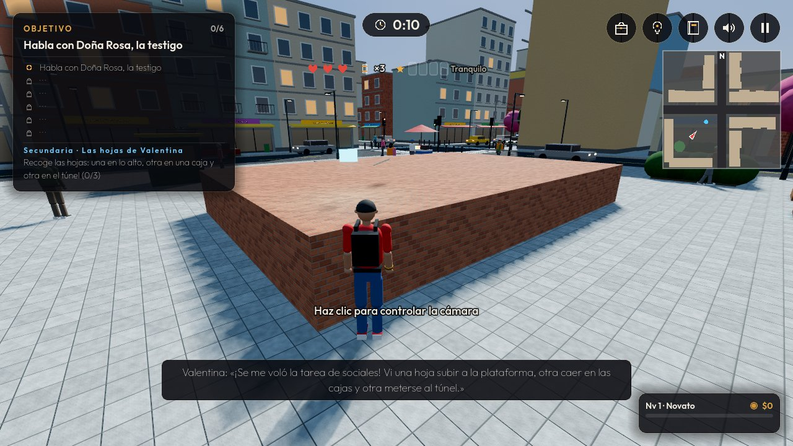
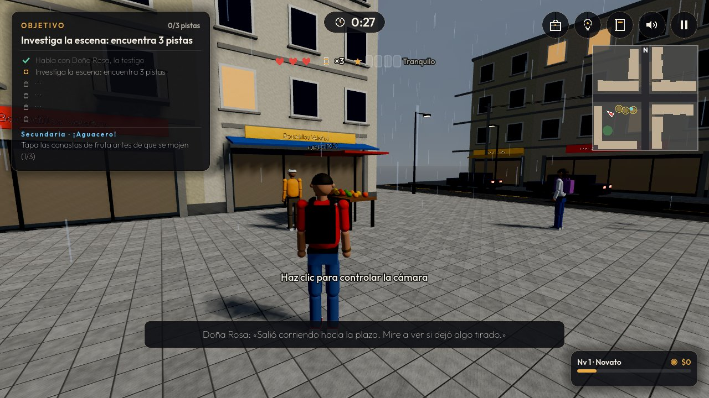
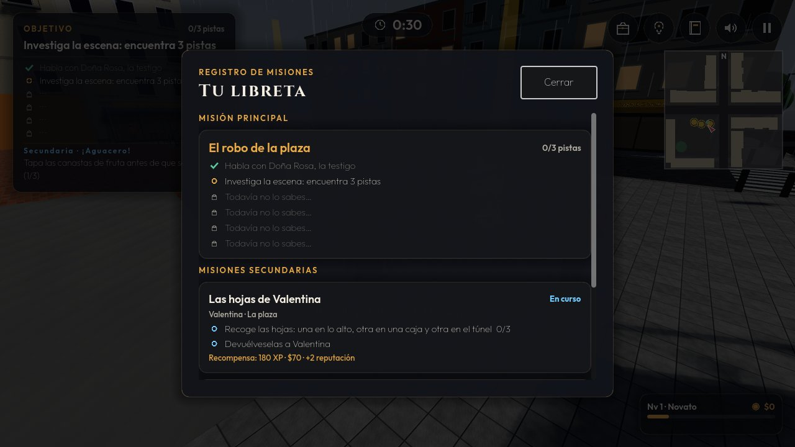
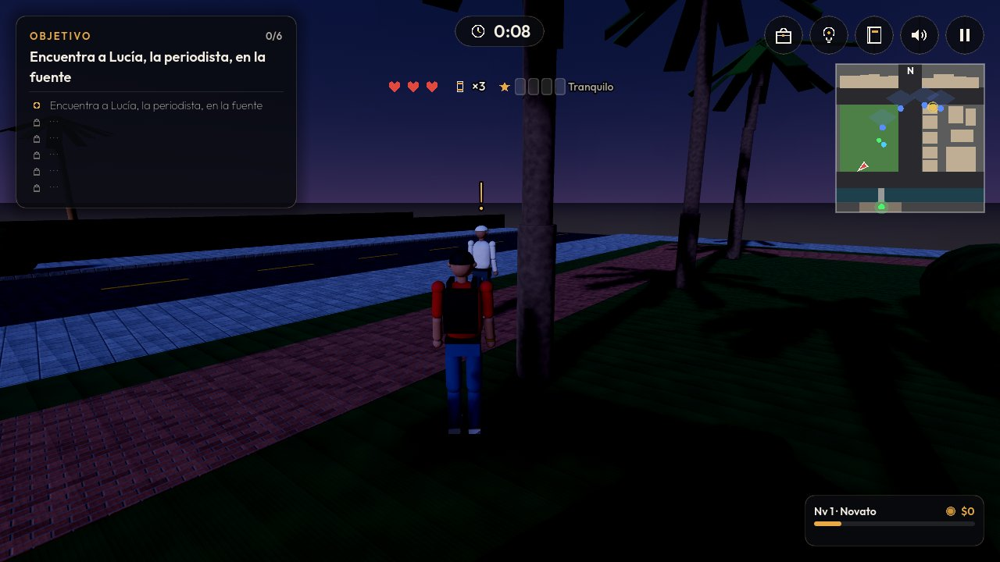

# Escape de Bucaramanga 2.2: vida de barrio

Versión 2.2.0 (17 de noviembre de 2026). Continúa la 2.0 con la primera mejora futura que quedó anotada: llevar las misiones secundarias fuera del Centro. No cambia la historia, los controles ni las partidas guardadas.

## Lo nuevo

### Misiones secundarias en cualquier capítulo
El sistema que en la 2.0 vivía dentro de `CentroMission` pasó a la clase base `Mission`. Cualquier capítulo puede tener secundarias creando `quests = QuestTracker.new()` y poniendo a quienes las entregan en `givers`. La base se encarga de lo común:

- los avisos al aceptar y al terminar;
- el «!» y el «?» sobre la cabeza;
- el guardado del progreso con la partida.

Cada misión de `SideQuests.LIST` dice ahora a qué capítulo pertenece (`"chapter"`), y el registro de misiones (J) muestra solo las del capítulo que estás jugando. Los objetivos de entrega (`"return": true`) se cumplen hablando con quien te dio la misión, y el «?» aparece cuando solo falta eso. En la 2.0, Mariana no mostraba el «?».

### Capítulo 2 · la manzana, de mañana

| Misión | Quién la da | Qué hay que hacer | Recompensa |
|---|---|---|---|
| Las hojas de Valentina | Valentina, junto al kiosco | Recoger tres hojas de cuaderno: una encima de la plataforma, otra sobre la caja de 1 m y otra dentro del túnel bajo (hay que agacharse) | 180 XP y $70 |
| ¡Aguacero! (evento) | Don Pacho, en su puesto de frutas | Cuarenta segundos después de hablar con Doña Rosa se larga a llover. Hay 45 s para tapar las tres canastas de fruta y avisarle a Don Pacho | 160 XP y $60 |

- El aguacero nunca empieza mientras sigues al ladrón o cuidas la caneca. Si ya estaba por empezar, espera a que termine esa parte.
- Durante el aguacero el cielo se pone gris, baja la luz y suena la lluvia. A los 75 s escampa.
- Si no alcanzas a tapar las canastas, el evento se pierde sin romper nada y no paga.
- Si la partida se guarda en medio del aguacero, al cargar el evento vuelve a empezar al rato, igual que el raponazo del Centro.

### Capítulo 5 · Cabecera, de madrugada

| Misión | Quién la da | Qué hay que hacer | Recompensa |
|---|---|---|---|
| Pan de madrugada | Don Ricardo, el panadero, al sur del Parque de las Palmas | Llevarles pan a Don Wilson, el celador del mirador, y a Doña Nubia, la taxista de la Carrera 33. Hay un bono opcional si ningún policía te ve mientras repartes | 200 XP, $90 y el bono (80 XP y $30) |

### Logros
- **Amigo del barrio** (nuevo, 22 en total): terminar las secundarias de la manzana y de Cabecera.
- «Buen vecino» sigue pidiendo solo las del Centro, así que quien ya lo tenía no lo pierde.

### Otros cambios
- Nuevo objeto de misión `QuestPickup` (`src/interaction/quest_pickup.gd`): hojas que flotan y canastas que se tapan con un plástico.
- `QuestTracker.abandon()` para eventos que se pierden. `ready_to_return()` decide cuándo mostrar el «?».
- Los textos de ayuda del menú ya mencionan las secundarias en la manzana y en Cabecera.

## Pruebas

**110 pruebas automáticas.** Son las 103 de la 2.0 más 7 nuevas:

- Cada misión nueva, de principio a fin, incluido el bono de sigilo y el logro «Amigo del barrio».
- Que las hojas se puedan pisar donde están y que nada quede dentro de un edificio.
- El aguacero:
  - completo;
  - perdido por tiempo;
  - en pausa mientras sigues al ladrón.
- El registro de misiones por capítulo: el capítulo 1 no lista secundarias y el 2 no muestra las del Centro.
- «Continuar» con hojas recogidas y con un aguacero a medias.

`test_security_camera_raises_alarm` falló una vez en la corrida completa y pasó tres veces seguidas sola. Ya había fallado así antes de estos cambios, así que es una prueba inestable del capítulo 3 y no tiene que ver con esta versión.

```bash
godot --headless --path . --fixed-fps 60 res://tests/test_runner.tscn
godot --path . --rendering-method gl_compatibility --resolution 1280x720 res://tests/v22_screenshots.tscn -- <carpeta> [bajo|medio|alto]
```

## Capturas







## Mejoras futuras
1. Secundarias en los capítulos 1, 3 y 4 (escape room, bodega y persecución bajo la lluvia).
2. Secretos propios de la manzana y de Cabecera, como las cigarras del Centro.
3. Un evento de ciclovía en la Carrera 33.
