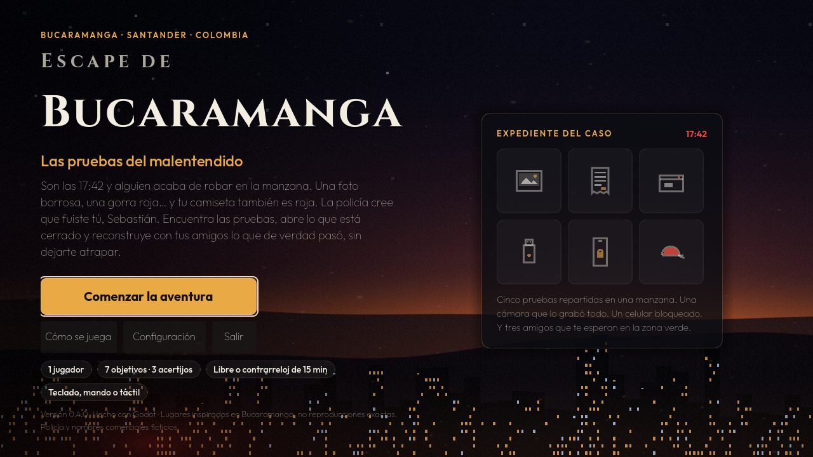
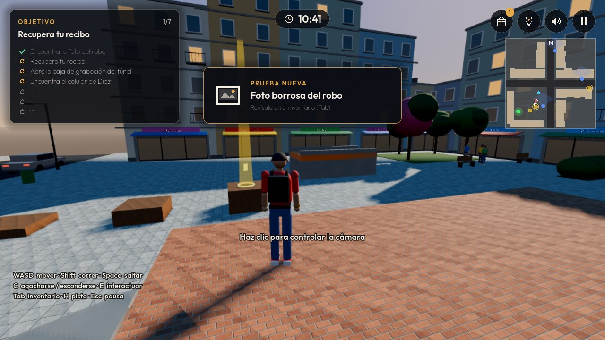
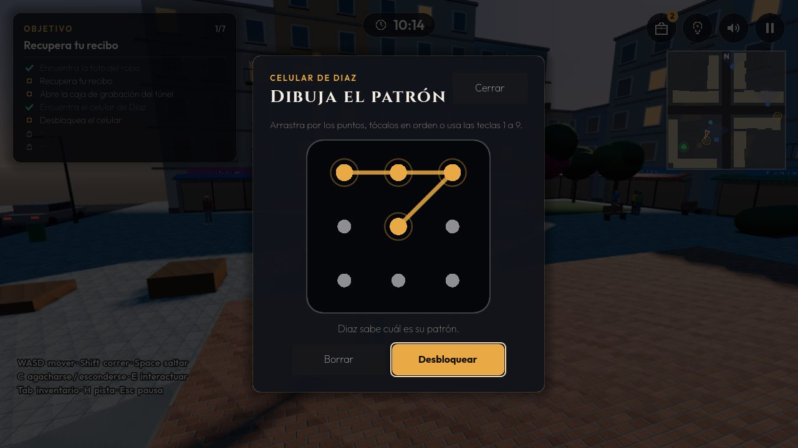
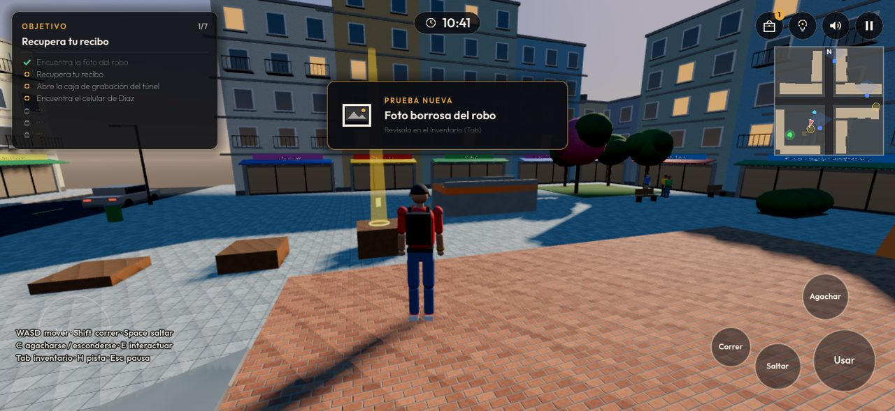

# Escape de Bucaramanga

Aventura urbana en tercera persona inspirada en Bucaramanga, Santander (Colombia), hecha en **Godot 4.7**. Sebastián y sus tres amigos recorren la ciudad para aclarar un malentendido mientras la policía (ficticia) los busca.

> Estado: **versión 0.4.0, escape room jugable** sobre la manzana de prueba. El plan completo está en [DOCUMENTACION/PLAN_DE_DESARROLLO.md](DOCUMENTACION/PLAN_DE_DESARROLLO.md).
> La versión 2D original está completa y jugable en [`clasico-2d/`](clasico-2d/).

Los lugares están inspirados en Bucaramanga; no son reproducciones exactas. La policía y los nombres comerciales son ficticios.

**Jugar en el navegador:** https://sebastianjaimesr.github.io/Escape_Bucaramanga_2/

## El caso: «Las pruebas del malentendido»

Son las 17:42 y alguien roba en la manzana. La foto muestra a alguien con gorra roja, y la camiseta de Sebastián también es roja: la policía cree que fue él. Hay que reunir las pruebas, abrir lo que está cerrado y reconstruir con Buitrago, Diaz y Gordo lo que de verdad pasó, sin dejarse atrapar.

- **7 objetivos y 3 acertijos:** una caja de grabación con clave, el patrón del celular de Diaz y la reconstrucción final. Todas las respuestas salen de las pruebas o de lo que dicen los amigos.
- **Inventario** (Tab) con cada prueba para examinar, **pistas por niveles** (H), **modo Explorador o Contrarreloj de 15 min**, guardado automático y «Continuar».
- **Policía ficticia** que patrulla, ve, oye, avisa por radio y te busca. Escóndete agachado en los matorrales.
- **Audio** sintetizado para el juego (música, ambiente y efectos) con volúmenes por separado.
- **Teclado y ratón, mando o pantalla táctil.** La interfaz se adapta a celulares en horizontal y en vertical.
- 54 pruebas automáticas.

Diseño, auditoría y arquitectura: [DOCUMENTACION/REDISENO_ESCAPE_ROOM.md](DOCUMENTACION/REDISENO_ESCAPE_ROOM.md).






## Ejecutar

Requiere Godot **4.7** (versión estándar). Ver [DOCUMENTACION/INSTALACION.md](DOCUMENTACION/INSTALACION.md).

```bash
godot --path .            # jugar
godot -e --path .         # abrir el editor
```

## Pruebas

```bash
godot --headless --path . --fixed-fps 60 res://tests/test_runner.tscn
# Capturas de la interfaz (necesita ventana)
godot --path . --rendering-method gl_compatibility --resolution 1280x720 res://tests/ui_screenshots.tscn -- <carpeta> [touch]
```

Detalle y resultados en [DOCUMENTACION/PRUEBAS.md](DOCUMENTACION/PRUEBAS.md).

## Documentación

| Documento | Contenido |
|---|---|
| [AUDITORIA_INICIAL.md](DOCUMENTACION/AUDITORIA_INICIAL.md) | Auditoría del juego 2D y elección del motor |
| [ARQUITECTURA.md](DOCUMENTACION/ARQUITECTURA.md) | Sistemas, carpetas, guardado, calidad gráfica, recursos |
| [PLAN_DE_DESARROLLO.md](DOCUMENTACION/PLAN_DE_DESARROLLO.md) | Las 12 fases y la campaña |
| [CONTROLES.md](DOCUMENTACION/CONTROLES.md) | Teclado, ratón, mando y reasignación |
| [INSTALACION.md](DOCUMENTACION/INSTALACION.md) | Preparar el entorno |
| [EXPORTACION_PC.md](DOCUMENTACION/EXPORTACION_PC.md) | Generar el `.exe` de Windows |
| [EXPORTACION_WEB.md](DOCUMENTACION/EXPORTACION_WEB.md) | Versión web y GitHub Pages |
| [PRUEBAS.md](DOCUMENTACION/PRUEBAS.md) | Pruebas y mediciones |
| [CHANGELOG.md](CHANGELOG.md) | Cambios por versión |

## Versión web

```bash
godot --headless --path . --export-release "Web" build/web/index.html
python -m http.server 8060 --directory build/web   # y abre http://localhost:8060
```

Publicación en GitHub Pages: ver [DOCUMENTACION/EXPORTACION_WEB.md](DOCUMENTACION/EXPORTACION_WEB.md).

## Créditos de recursos

- Tipografías Cinzel y Outfit, SIL Open Font License 1.1 (licencias en `assets/fonts/`).
- Música, ambiente y efectos generados con `tools/generate_audio.py` (síntesis propia, sin muestras de terceros).
